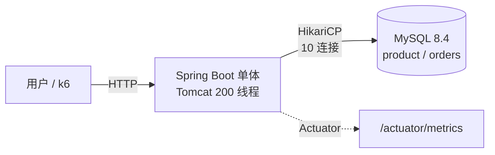
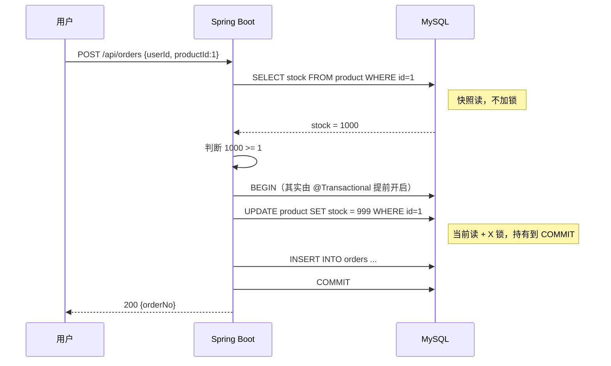

# 架构演进

每个版本一张图，加一节"为什么这么做"。决策必须有依据，依据必须有数字。

---

## V1 — 单体 + 直接查库

### 架构图

**这版没有 Nginx、没有 Redis、没有 MQ。** 故意的——先把最朴素的样子跑起来，用压力把它压坏，后面的每一层才有存在理由。

### 数据流：一次下单

**问题出在哪**：`SELECT` 到 `UPDATE` 之间没有保护。两个请求可以都读到 1000，都算出 999，都写回 999——卖了两单，扣了一件。这是 V0.1 `count++` 的数据库版。

### 关键决策

| 决策 | 选择 | 理由 |
|---|---|---|
| 数据访问 | **JdbcTemplate**，不用 JPA | 每条 SQL 必须看得见。V1 就是要让人看清"查了两次、改了一次"，ORM 会把这层藏起来 |
| 分层 | controller / service / repository | V2 要在 service 插 Redis、在 repository 外挂 MQ。V1 不分开，V2 就得重写 |
| 事务边界 | `@Transactional` 包住 UPDATE + INSERT | 扣库存和写订单必须一起成功或一起失败 |
| 连接池 | **故意设 10** | 够用即可。V0.4 实测 4 线程就能打满单行热点，池子开大只会增加等锁的人 |
| 错误码 | 200 / **409 售罄** / 5xx | 409 是业务结果。压测如果不分开统计，"卖完了"会被算成"系统故障" |
| 幂等 | **不做** | 订单表故意不加 `UNIQUE(user_id, product_id)`。同一用户连点两次会产生两单，留给 V2 |
| 库存写法 | **覆盖式** `SET stock = ?` | 故意的错误写法。V1-b 会换成条件更新并对比数据 |

### 实测结果（详见 [BENCHMARK.md](BENCHMARK.md)）

| 指标 | 值 |
|---|---|
| 单 SKU 吞吐天花板 | **~950 /s**（到达率从 1000 加到 4000，吞吐只涨 4%） |
| 饱和时 P99 | **3.9 s** |
| MySQL CPU | **19%** |
| 应用 CPU | **1.3%** |
| 超卖 | 库存 10，60 并发 → **成功 43 单** |
| 对照组：分散到 9 万 SKU | **1989 /s，P99 46 ms** |

### 为下一版留下的问题

1. **超卖**：需要把"判断 + 扣减"合成一个原子操作。
2. **吞吐**：单行热点封顶在 950，加连接池无效（实测 10 → 50 吞吐不变）。
3. **怎么证明是热点而不是别的原因**：用"分散到 9 万 SKU"做对照，吞吐翻倍、P99 从 3.9s 降到 46ms——排他性证据。

> **V2 的立项理由不是"Redis 比较快"，是"V1-a 的对照实验证明瓶颈就是单行串行写"。**

---

## V2 — Redis 预扣库存 + MQ 削峰

（待开始）

## V3 — 多实例 + 限流 + 可观测

（待开始）
