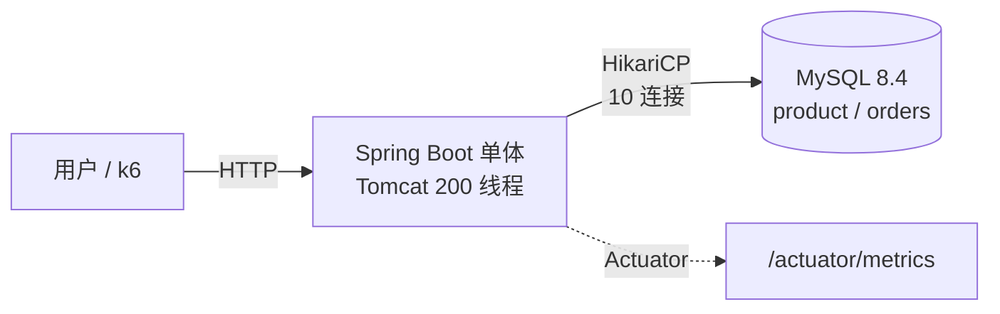
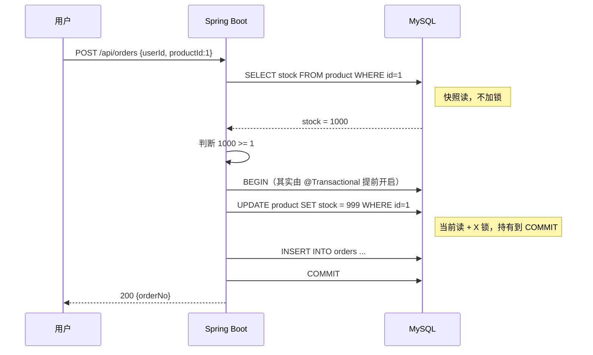
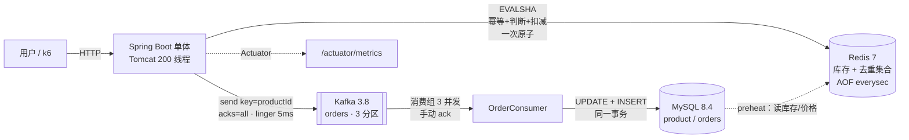
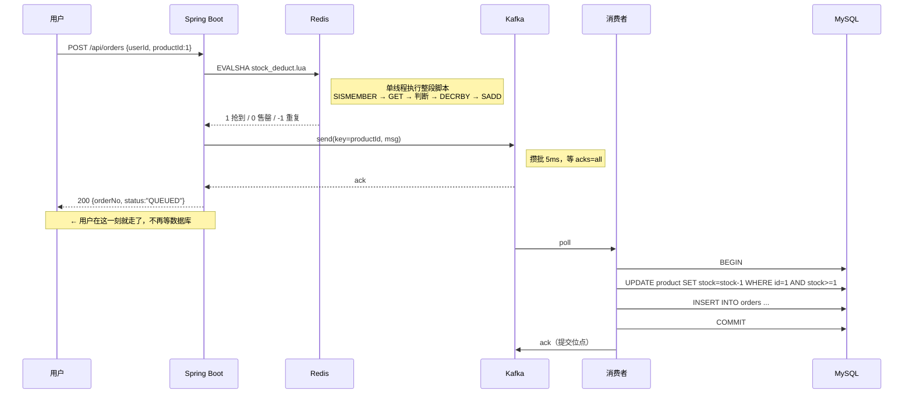

# 架构演进

每个版本一张图，加一节"为什么这么做"。决策必须有依据，依据必须有数字。

---

## V1 — 单体 + 直接查库

### 架构图



**这版没有 Nginx、没有 Redis、没有 MQ。** 故意的——先把最朴素的样子跑起来，用压力把它压坏，后面的每一层才有存在理由。

### 数据流：一次下单



**问题出在哪**：`SELECT` 到 `UPDATE` 之间没有保护。两个请求可以都读到 1000，都算出 999，都写回 999——卖了两单，扣了一件。这是 V0.1 `count++` 的数据库版。

### 关键决策

| 决策 | 选择 | 理由 |
|---|---|---|
| 数据访问 | **JdbcTemplate**，不用 JPA | 每条 SQL 必须看得见。V1 就是要让人看清"查了两次、改了一次"，ORM 会把这层藏起来 |
| 分层 | controller / service / repository | V2 要在 service 插 Redis、在 repository 外挂 MQ。V1 不分开，V2 就得重写 |
| 事务边界 | `@Transactional` 包住 UPDATE + INSERT | 扣库存和写订单必须一起成功或一起失败 |
| 连接池 | **故意设 10** | 够用即可。V0.4 实测 4 线程就能打满单行热点，池子开大只会增加等锁的人 |
| 错误码 | 200 / **409 售罄** / 5xx | 409 是业务结果。压测如果不分开统计，"卖完了"会被算成"系统故障" |
| 幂等 | **不做** | 订单表故意不加 `UNIQUE(user_id, product_id)`。同一用户连点两次会产生两单，留给 V2 |
| 库存写法 | **覆盖式** `SET stock = ?` | 故意的错误写法。V1-b 会换成条件更新并对比数据 |

### 实测结果（详见 [BENCHMARK.md](BENCHMARK.md)）

| 指标 | 值 |
|---|---|
| 单 SKU 吞吐天花板 | **~950 /s**（到达率从 1000 加到 4000，吞吐只涨 4%） |
| 饱和时 P99 | **3.9 s** |
| MySQL CPU | **19%** |
| 应用 CPU | **1.3%** |
| 超卖 | 库存 10，60 并发 → **成功 43 单** |
| 对照组：分散到 9 万 SKU | **1989 /s，P99 46 ms** |

### 为下一版留下的问题

1. **超卖**：需要把"判断 + 扣减"合成一个原子操作。
2. **吞吐**：单行热点封顶在 950，加连接池无效（实测 10 → 50 吞吐不变）。
3. **怎么证明是热点而不是别的原因**：用"分散到 9 万 SKU"做对照，吞吐翻倍、P99 从 3.9s 降到 46ms——排他性证据。

> **V2 的立项理由不是"Redis 比较快"，是"V1-a 的对照实验证明瓶颈就是单行串行写"。**

---

## V1-b — 一行 SQL 修好超卖

### 改动

```java
// V1-a（错）：应用算好绝对值盖回去
UPDATE product SET stock = ? WHERE id = ?

// V1-b（对）：把判断塞进 WHERE，看影响行数
UPDATE product SET stock = stock - ? WHERE id = ? AND stock >= ?
```

```java
int affected = products.deductStock(productId, quantity);
if (affected == 0) throw new SoldOutException();   // 0 行 = 没抢到
```

### 为什么这样是对的

`UPDATE` 是**当前读 + 排他锁**：定位 → 加锁 → 读最新值 → 判断 → 减 → 持有锁到提交。
**判断发生在锁内**，中间没人能插进来。

对照 V0.1：

| MySQL | Java |
|---|---|
| `SELECT` 判断再 `UPDATE` | `count++` |
| `UPDATE ... WHERE stock >= ?` | `AtomicInteger.incrementAndGet()` |
| `SELECT ... FOR UPDATE` | `synchronized` |

### 结果

| | 结果 |
|---|---|
| 超卖 | **0 单**（库存 10，60 并发，正好成功 10 单） |
| 吞吐 | **880–991 /s**，与 V1-a 持平 |
| 售罄时吞吐 | **~1,900 /s**（快一倍，因为不写盘） |

**修正确性几乎不花性能**——因为锁本来就在，只是把判断挪到了锁内。

### 仍然存在的问题

1. 单 SKU 吞吐还是 ~950/s，没变（瓶颈没解决，只是不再出错）
2. 仍然每单都打 MySQL 同一行
3. 没有幂等（同一用户连点两次仍是两单）
4. 没有削峰，流量原样打到数据库

> **V1-b 只解决了"对不对"，没解决"扛不扛得住"。** 后者是 V2 的事。

---

## V2 — Redis 预扣库存 + MQ 削峰

### 架构图



**请求路径上没有 MySQL 了**——这是 V2 和 V1 最本质的区别。

### 数据流：一次下单



**异步化真正省掉的**：请求线程不再等 `fsync`。V1 里一个事务要等 redo/binlog 落盘才能提交，
这也是 V1-b 只有 950/s 而裸 MySQL 能到 2,000/s 的原因。

### 关键决策

| 决策 | 选择 | 理由 |
|---|---|---|
| 库存放哪 | **Redis**，不是 MySQL 行 | 单行 `UPDATE` 是串行的；Redis 是内存 + 单线程，扣一次 ~0.1ms |
| 原子性怎么保证 | **Lua 脚本** | 整段脚本在服务端一次执行，中间插不进别的命令 = 一次 CAS。用 `MULTI` 拿不到中间结果做判断，用 `WATCH` 要重试 |
| Redis 的定位 | **账本，不是缓存** | 所以配 AOF `everysec`、`maxmemory-policy noeviction`。默认的 `allkeys-lru` 会把库存 key 淘汰掉 |
| 为什么加 MQ | **Kafka**，不是应用内队列 | 进程一重启队列就没了；Kafka 有持久化、有重投、有消费位点 |
| 消息顺序 | key = `productId` | 同一商品进同一分区，消费者按序处理，库存不会有乱序扣减 |
| 投递语义 | `acks=all` + 幂等生产者 + **手动 ack** | 至少一次。重复由 `uk_order_no` / `uk_user_product` 挡住 |
| 攒批 | `linger.ms=5` | **实测改 0 更差**（P99 127→777ms）。攒批是投资不是成本 |
| `200` 的含义 | **"抢到名额，排队中"** | 契约变更，前端必须轮询。不说清楚就是线上事故 |
| MySQL 那层还留条件更新吗 | **留**，作为兜底 | Redis 数据可能旧；`WHERE stock >= ?` 保证 MySQL 永不扣成负数 |
| 幂等 | Redis Set + **唯一索引**双层 | Set 有 `EXPIRE 86400`，订单要永久；唯一索引才是最后一道 |

### 实测结果（详见 [BENCHMARK.md](BENCHMARK.md) 和 [v2/experiment.md](v2/experiment.md)）

| 指标 | V1-b | V2 | 变化 |
|---|---|---|---|
| 请求侧吞吐 | 950 /s | **3,000 /s**（P99 16ms） | **3.2 倍** |
| 消费/落库速率 | 950 /s | **950 /s** | **没变** |
| 超卖 | 0 | 0 | — |
| 幂等 | 无 | 有（双层） | — |
| 对账 | — | **137,215 = 137,215 = 137,215** | 零丢失零重复 |
| 峰值内存积压 | 无 | 结束时 lag 最高 7.3 万 | 需要监控 |

### 仍然存在的问题

1. **瓶颈没被消灭，被搬到了下游。** 落库还是 950/s，多出来的全部堆在 Kafka 里。
   库存 100 万、到达率 3,000/s 的活动，结束时积压 68 万条，**要排空 12 分钟**。
2. **真正的容量上限未知**（3,000~5,400 之间）。k6 和被测系统同机，超过 3,000 就测不准。
3. **没有限流。** 8,000/s 打进来，200 个 Tomcat 线程全占满，每个请求占 37ms，
   结果是**所有人一起变慢**，而不是"一部分人快速失败"。这是可用性问题，比吞吐问题更严重。
4. **没有可观测性。** Kafka lag、Redis 命中率、P99、错误率全靠压测脚本临时采，
   线上出事只能靠猜。
5. **没有降级预案。** Redis 挂了怎么办？Kafka 挂了怎么办？现在是直接 5xx。
6. 37ms 里还有 ~30ms 没定位（已排除 `linger.ms`）。
7. 全部单点：MySQL / Redis / Kafka 都没有副本。

> **V2 的准确结论：它让"扛住流量"变成真的（请求侧 3 倍），
> 但没让"处理完订单"变快（落库 950/s 纹丝不动）。
> 前者靠 Redis，后者只能靠分桶——而分桶之前，必须先有限流和观测。**

## V3 — 限流 + 可观测 + 多实例 + 故障演练

（规划中，见下节）

### V3 要回答的三个问题

1. 既然只能吃 3,000/s，**怎么让 8,000/s 打进来时不崩**？（限流 + 快速失败）
2. 线上怎么知道自己在哪个位置？**（Prometheus + Grafana + lag 告警）**
3. 依赖挂了会怎样？**（故障演练：杀 Redis / 杀 Kafka / 杀 MySQL）**

> V3 不追求更高的吞吐。**它的目标是把"已知的容量"变成"可控的系统"。**
